# 📚 BookNest – Online Book Store

An online book store where readers can browse books, add them to a shopping bag and order with **cash on delivery**. Store staff manage books and orders from an **admin panel**.

Built with **HTML5, CSS3, Bootstrap 5, JavaScript, PHP and MySQL**.

🌐 **Live demo:** http://booknest-azlal.infinityfreeapp.com

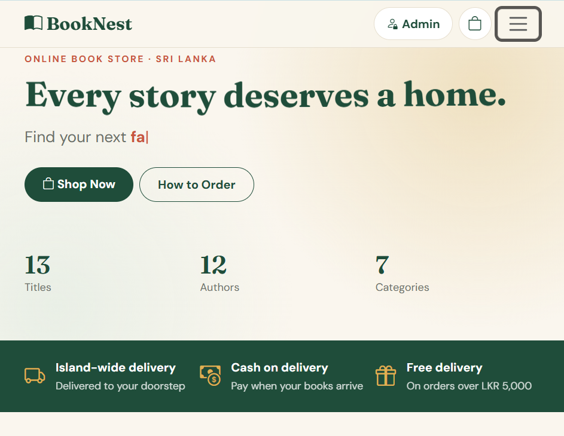

---

## ✨ Features

### Shop (customers)
- **Animated text**: wave-style heading, typewriter line, blur-reveal section titles, counting numbers
- Book catalogue with real covers (loaded automatically from the ISBN)
- Category filters, live search, and sorting by price or title
- Book details popup with description, stock status and quantity picker
- Shopping bag that is saved in the browser, with a free-delivery progress message
- Checkout with delivery details and cash on delivery
- Order confirmation with an order number; stock goes down automatically

### Admin panel (store staff)
- Secure login
- Dashboard: total books, copies in stock, low stock, orders, pending orders, revenue
- **Full CRUD for books**: Create, Read (search), Update, Delete, with a live cover preview
- Order management: Pending → Shipped → Delivered, or Cancelled (cancelling puts the books back into stock)

---

## 🖼️ Screenshots

### Shop

| Book collection | Book details |
|---|---|
|  |  |

| Shopping bag | Checkout | Order placed |
|---|---|---|
| 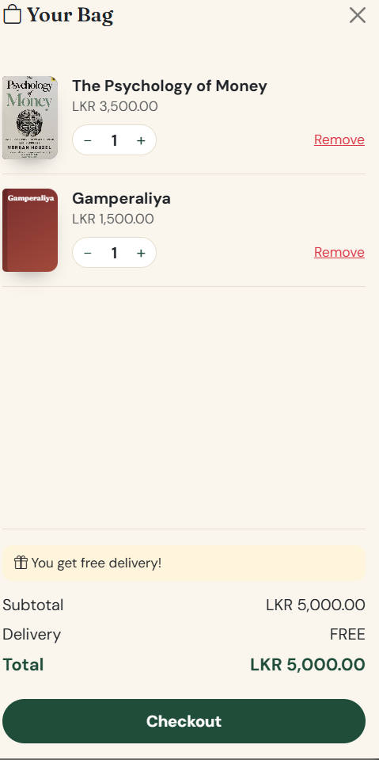 | 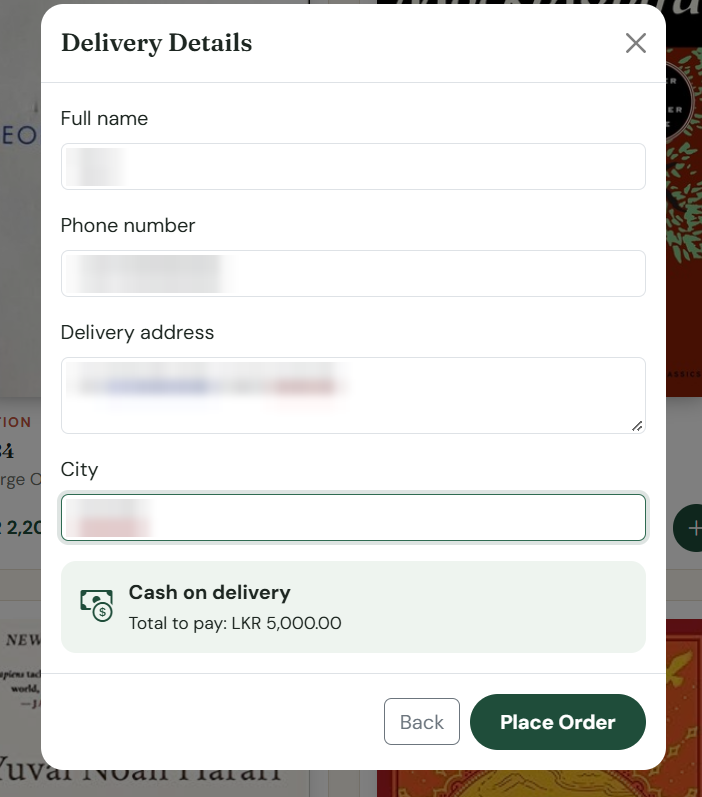 | 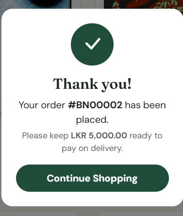 |

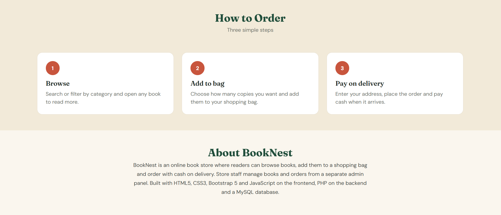

### Admin panel

| Login | Add new book | Edit book |
|---|---|---|
| 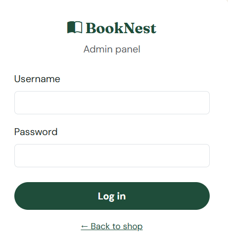 | 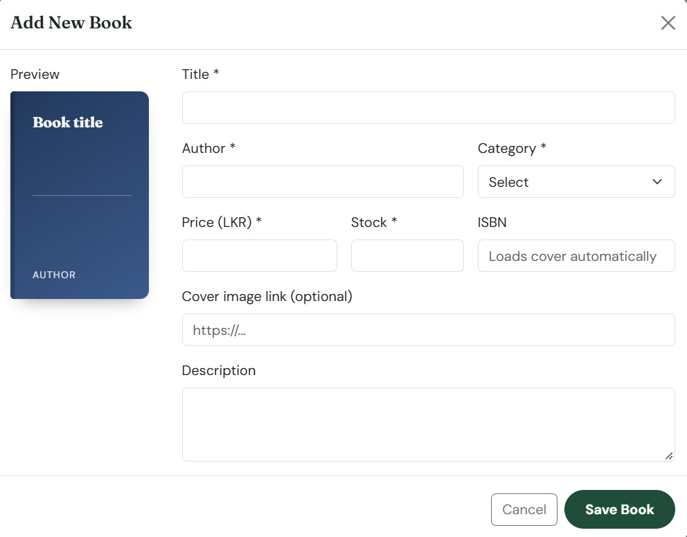 | 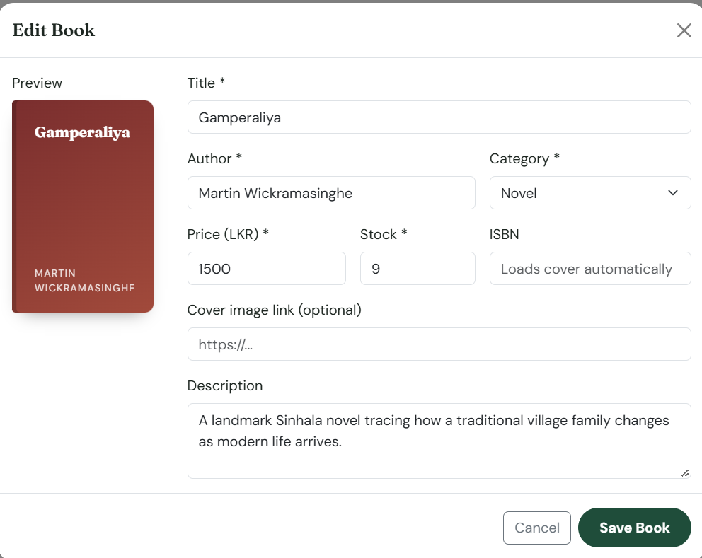 |

**Dashboard: book management (CRUD)**

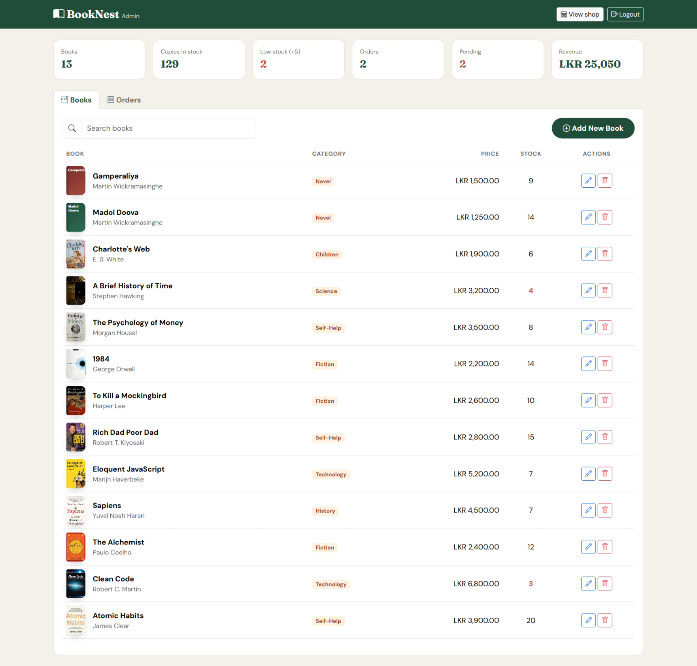

**Orders**

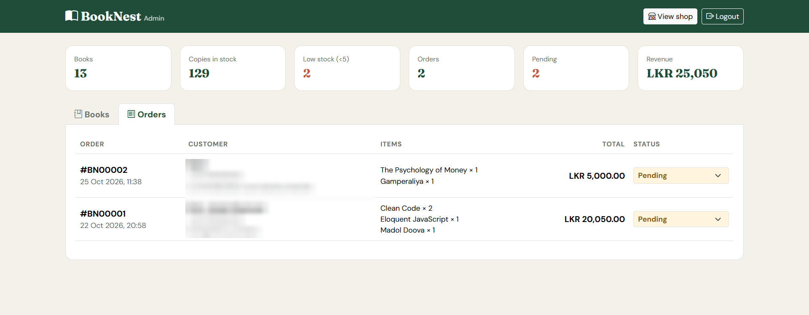

---

## 🛠️ Technologies

| Layer | Technology |
|---|---|
| Frontend | HTML5, CSS3, Bootstrap 5, Bootstrap Icons, JavaScript (Fetch API) |
| Backend | PHP (PDO with prepared statements) |
| Database | MySQL |
| Book covers | Open Library Covers API |

---

## 📁 Project Structure

| File | Purpose |
|---|---|
| `index.php` | Shop page |
| `admin.php` | Admin login and dashboard |
| `api.php` | Backend: all database operations (books CRUD, orders, stats) |
| `config.php` | Database, admin login and delivery settings |
| `database.sql` | Creates the tables and sample books |
| `common.js` | Shared helpers (API calls, book covers, formatting) |
| `shop.js` | Shop logic, animated text, shopping bag and checkout |
| `admin.js` | Admin CRUD and order management |
| `style.css` | Styles and animations |

---

## 🗄️ Database

Three tables:

- **`books`**: id, title, author, category, isbn, description, price, stock, cover_url, created_at, updated_at
- **`orders`**: id, customer_name, phone, address, city, subtotal, delivery_fee, total, status, created_at
- **`order_items`**: id, order_id → orders, book_id → books, title, price, quantity

**Database creation**

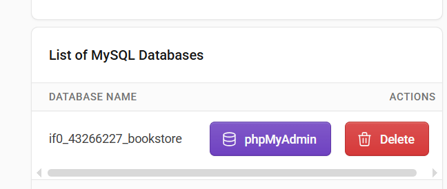

**SQL queries (tables created and sample books inserted)**

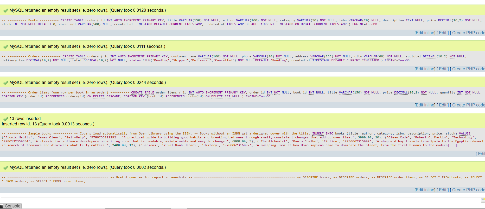

**`books` table structure**

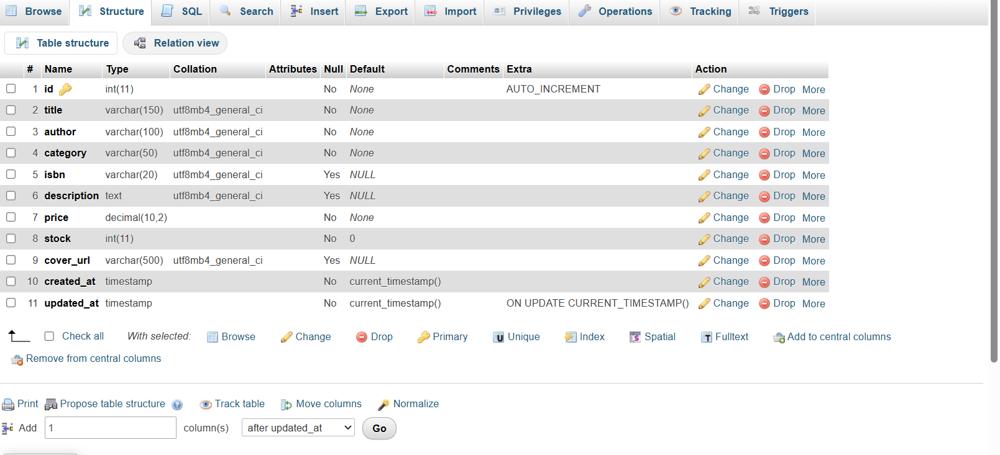

**`books` table data**

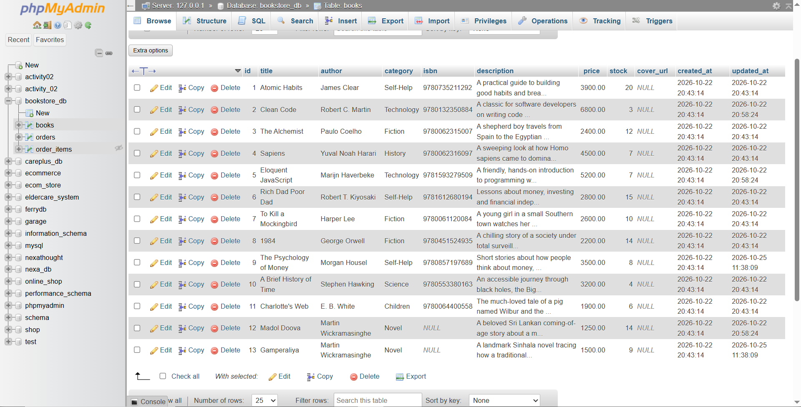

**`orders` table** (customer details blurred)

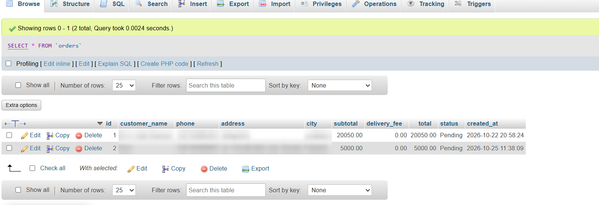

**`order_items` table**

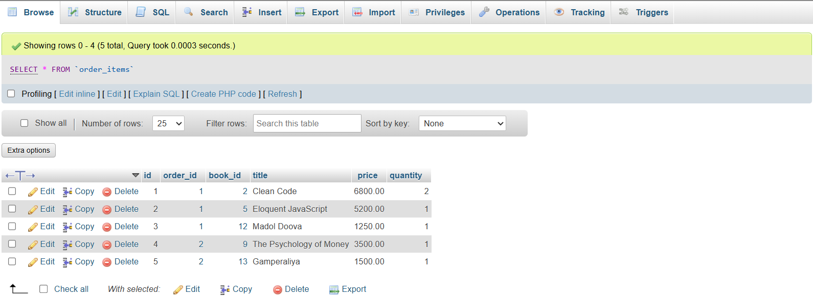

---

## 🚀 Run Locally (XAMPP)

1. Start **Apache** and **MySQL** in the XAMPP Control Panel.
2. Copy the project folder into `C:\xampp\htdocs\booknest`.
3. Open `http://localhost/phpmyadmin`, go to the **SQL** tab, paste the contents of `database.sql` and click **Go**.
4. Open the shop at **`http://localhost/booknest/`**.
5. Click **Admin** in the navbar to open the admin panel.

**Demo admin login** (local testing only): `admin` / `admin123`

> Change `ADMIN_PASS` in `config.php` before putting the site online.

---

## 🌐 Deploy (InfinityFree)

1. Create a hosting account and a MySQL database in the control panel.
2. Open phpMyAdmin for that database and run `database.sql` **starting from `DROP TABLE`**.
3. In `config.php`, comment out the XAMPP settings, fill in your InfinityFree database details, and change the admin password.
4. Upload all project files into the `htdocs` folder.

---

## 👩‍💻 Author

**Rifdha Zainab**
